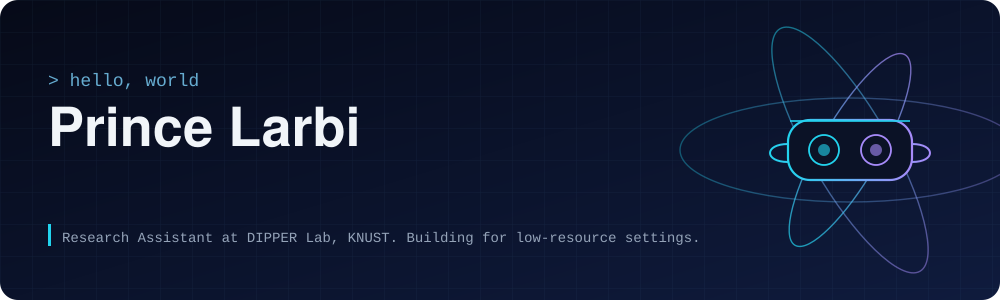
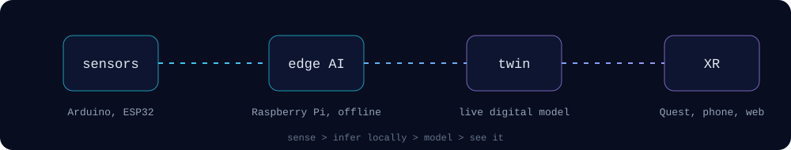

  

I build virtual reality, IoT and edge AI systems that run well where resources are limited. I am a Research Assistant at the Distributed IoT Platforms, Privacy, and Edge-Intelligence Research Lab (DIPPER Lab) at Kwame Nkrumah University of Science and Technology.

  

## What I work on

- **XR.** Virtual and extended reality for teaching, lab guidance and outreach, on Meta Quest, phone and web.
- **Edge AI.** Language and speech models made small enough to run offline on a Raspberry Pi.
- **IoT and digital twins.** Arduino and ESP32 sensing, linked to live models.
- **Assistive tech and local languages.** Tools for accessibility and for Ghanaian language translation and speech.
- **Community.** Wikimedia Technical, NASA Space Apps Kumasi, and open source.

## Skills

  

## GitHub in numbers

  
  

## Off the clock

Anime (recommendations welcome), learning new languages both coding and spoken, flying drones, and nature walks.

## Find me

[Portfolio](https://larbi.xyz) | [LinkedIn](https://www.linkedin.com/in/princelarbi/) | [X](https://twitter.com/Pkwolffe)
